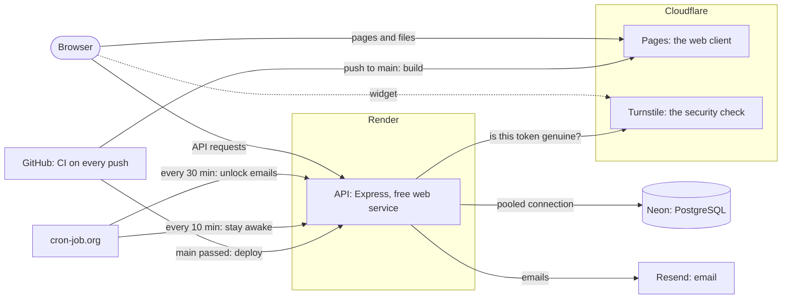

# ⏳ TimeCapsule

**Write a message now, and it stays locked until the date you choose.** Send it to your future self, schedule a birthday surprise, or keep a journal entry you can't reread for a year.

## What it does

- **Create a capsule:** a title, a message, and a future unlock date
- **Locking enforced on the server:** until the unlock date, the API returns a capsule's title and date (to its owner) but never its message, so the lock can't be bypassed from the browser
- **Private or shareable:** private capsules are visible only to their owner; public ones get a random share link (`slug`) that anyone can open once the capsule unlocks
- **Emailed when it opens:** the owner gets an email with a link to the capsule, and a recipient the owner named gets the message itself
- **A wait you can see:** a sealed capsule is an airmail envelope whose stamp shows the time left, its page counts down to the second, and it unfolds into a letter when it opens. Every date is shown in your own time zone, named, and the form warns you about the nights the clocks change
- **Accounts:** sign up with an email address you confirm through an emailed link, log in with a password hashed by bcrypt, stay signed in with a JWT (a signed token the client sends with each request), and reset a forgotten password by email
- **Bots kept out:** signing up and asking for a password reset pass Cloudflare Turnstile's check, which tells people from bots and usually asks nothing at all

## Tech stack

| Layer | Stack |
| --- | --- |
| Backend | Node.js 24 + Express 5 |
| Database | PostgreSQL + Prisma ORM |
| Auth | bcrypt password hashing + JWT bearer tokens; [Cloudflare Turnstile](https://www.cloudflare.com/application-services/products/turnstile/) on signup and password reset |
| Email | [Resend](https://resend.com)'s HTTP API; printed in the server's log when no API key is set |
| Scheduler | [cron-job.org](https://cron-job.org) calls the unlock-email job every 30 minutes |
| Frontend | React 19 + React Router 7 + Vite + Tailwind CSS 4 (`timecapsule-client/`) |
| Tests | Jest + Supertest for the API; Playwright end to end, in Chrome (`e2e/`); GitHub Actions runs them all |
| Hosting | API on [Render](https://render.com), database on [Neon](https://neon.com), web client on [Cloudflare Pages](https://pages.cloudflare.com), all on free plans |

## API

| Method | Route | Auth | What it does | Success |
| --- | --- | --- | --- | --- |
| `POST` | `/signup` | — | Sign up (`email`, `password`, `captchaToken`): emails a link to confirm the address; returns `{ message }` | 202 |
| `POST` | `/verify-email` | — | Confirm an address with the link's `token`; returns `{ message, email }` | 200 |
| `POST` | `/login` | — | Log in, once the address is confirmed; returns `{ token, user }` | 200 |
| `POST` | `/forgot-password` | — | Email a link to choose a new password (`email`, `captchaToken`); returns `{ message }` | 202 |
| `POST` | `/reset-password` | — | Set a new password with the link's `token` (`token`, `password`); returns `{ token, user }` | 200 |
| `GET` | `/capsules` | ✔ | Your capsules, soonest unlock first; `message` is `null` until each one unlocks | 200 |
| `POST` | `/capsules` | ✔ | Create a capsule (`title`, `message`, `unlockDate`, `isPublic`, optional `recipientEmail`) | 201 |
| `GET` | `/capsules/slug/:slug` | ✔ | Open a capsule you own, or anyone's public one | 200 |
| `DELETE` | `/capsules/:id` | ✔ | Delete a capsule you own | 200 |
| `GET` | `/capsules/public/:slug` | — | Open a public capsule by its share link | 200 |
| `POST` | `/jobs/unlock-emails` | job secret | Run the unlock-email job (see below); only exists when `JOB_SECRET` is set | 200 |
| `GET` | `/` | — | Answers `Time Capsule API` without touching the database: for the host's health checks and the keep-awake pings | 200 |
| `GET` | `/health` | — | Asks the database too: `{ "status": "ok", "database": "ok" }`, or 503 `DATABASE_UNAVAILABLE` | 200 |
| `GET` | `/ip` | — | `{ "ip": ... }`: the caller's address as the API sees it, which is what rate limits count (for checking `TRUST_PROXY`) | 200 |

For authenticated routes, send `Authorization: Bearer <token>`. A token lasts one day, and stops working early when
the account's password is reset. The job route takes `Authorization: Bearer <JOB_SECRET>` instead.

**The security check.** Signing up and "forgot password" email whatever address they're given, so when the server
has `TURNSTILE_SECRET_KEY` (always in production) they also need `captchaToken`: the token Cloudflare Turnstile's
widget gives the page. The server asks Cloudflare whether it's genuine before doing anything else; each token works
once, for 5 minutes. Without the secret key, the check is off and `captchaToken` is ignored.

**Accounts and emailed links.** Signing up and "forgot password" answer the same way whether or not the address has
an account (so neither reveals who has one); the emails tell the difference. A confirmation link works for 24 hours, a
password reset link once, for 1 hour, and the links carry their secret after `#` (`/verify-email#token=...`), which
browsers never send to servers. Only a hash of each secret is stored. Logging in with the right password before
confirming answers 403 and emails a new link. Resetting the password logs out every session and also confirms the
address.

**Emails when a capsule opens.** `POST /jobs/unlock-emails` (called every 30 minutes by the scheduler, or
`npm run job:unlock-emails` by hand) emails each capsule whose date has passed: its owner gets a link to read it, and
the `recipientEmail`, if any, gets the title and message, with replies going to the owner. It sends each email once,
even if runs overlap or crash, and answers a summary:
`{ capsulesNotified, capsulesGivenUp, emailsSent, emailsFailed, stoppedBy, cleanedUp }`. `stoppedBy` is `null`, or why
the run stopped early: `time-limit`, `daily-limit`, `provider-quota`, `provider-unavailable` or `provider-config` (the
last answers 502 instead, since only a person can fix it); the next run carries on.

**Email limits.** The email provider's free plan sends 100 emails a day (`EMAIL_DAILY_LIMIT`), so the server rations
them: account emails (links, notices) take at most half of a day, capsule emails at most 90%, one owner's capsule
emails at most a quarter, and one address gets at most 3 account emails an hour. When the day's account emails are
used up, signups and password reset requests answer 503 until midnight UTC; capsule emails wait for the next run.

**Locked capsules.** Until its unlock date, a capsule answers `{ "status": "locked", "unlocksAt": "..." }`; after
it, `{ "status": "unlocked", "capsule": { ... } }`. The message is never sent before the unlock date, not even to the
owner. `GET /capsules/slug/:slug` also says `isOwner`: its owner gets everything they set (`id`, `title`,
`unlockDate`, `isPublic`, `slug`, `recipientEmail`, `createdAt`, and `message` once it unlocks), anyone else what the
share page shows (`title`, `message`, `unlockDate`, `createdAt`, once it unlocks).

**Input rules.** Email: a valid address of at most 254 characters (case and surrounding spaces don't matter).
Password: at least 8 characters and at most 72 bytes. Title: up to 200 characters; message: up to 10,000.
`unlockDate`: ISO 8601 with a time zone (like `2030-01-01T09:00:00Z`), in the future, at most 50 years ahead.
`isPublic`: `true` or `false`. `recipientEmail`: an email address like the account's, or empty/`null` for nobody;
only the owner ever sees it. Request bodies: at most 64 kB.

**Errors** all have one shape: `error` is a sentence for people, `code` is for programs, and `details` (validation
errors only) lists every problem.

```json
{
  "error": "Unlock date must be in the future",
  "code": "VALIDATION_FAILED",
  "details": [{ "field": "unlockDate", "message": "Unlock date must be in the future" }]
}
```

| Status | `code` | When |
| --- | --- | --- |
| 400 | `VALIDATION_FAILED`, `INVALID_JSON`, `BAD_REQUEST` | Missing or invalid fields; a body that isn't valid JSON |
| 400 | `INVALID_LINK` | A confirmation or password reset link that is unknown, expired or already used |
| 400 | `CAPTCHA_FAILED` | Signing up or asking for a password reset without a `captchaToken` Cloudflare vouches for (missing, used, expired or fake) |
| 401 | `AUTH_REQUIRED`, `INVALID_TOKEN`, `TOKEN_EXPIRED`, `TOKEN_REVOKED`, `INVALID_CREDENTIALS` | No (or a malformed) `Authorization` header; a bad or expired token, or one made before the password was reset; a wrong email or password; a wrong job secret |
| 403 | `EMAIL_NOT_VERIFIED` | Logging in before confirming the address (a new link is emailed) |
| 403 | `FORBIDDEN` | Deleting someone else's public capsule |
| 404 | `NOT_FOUND` | No such route, or no capsule you may see: someone else's private capsule looks exactly like a missing one |
| 413 | `PAYLOAD_TOO_LARGE` | A request body over 64 kB |
| 429 | `RATE_LIMITED` | Too many requests; the `Retry-After` header says how many seconds to wait |
| 500 | `INTERNAL_ERROR` | A bug or an outage; the cause goes to the server log, never into the response |
| 502 | `EMAIL_PROVIDER_ERROR` | The unlock-email job: the email provider refused the server's API key or sender address |
| 503 | `EMAIL_LIMIT_REACHED` | Signing up or resetting a password once the day's account emails are used up; `Retry-After` says when they reset |
| 503 | `CAPTCHA_UNAVAILABLE` | The security check can't be done: Cloudflare can't be reached or refused the server's secret key (logged) |
| 503 | `DATABASE_UNAVAILABLE` | `GET /health`: the database didn't answer within 10 seconds (logged) |

**Rate limits**, per IP address: 1,000 requests per 5 minutes in total, 30 account requests (signing up, confirming an
address, logging in, resetting a password) per 15 minutes, and 10 failed logins per 15 minutes. Every response carries
`RateLimit` and `RateLimit-Policy` headers.

## Running it locally

**You'll need:** Node.js 24 LTS and Docker (for the PostgreSQL database).

```bash
git clone https://github.com/mercyy1/Time-Capsule.git
cd Time-Capsule
docker compose up -d          # PostgreSQL on 127.0.0.1:5432 (dev and test databases)

cd timecapsule-server
npm ci                        # also generates the Prisma client
cp .env.example .env          # then set JWT_SECRET (the file says how to generate one)
npm run db:deploy             # creates the tables
npm run dev                   # API on http://localhost:5000

# in a second terminal, from the repository root
cd timecapsule-client
npm ci
cp .env.example .env          # VITE_API_URL=http://localhost:5000
npm run dev                   # app on http://localhost:3000
```

Locally, emails aren't sent: the server prints each one, links included, in its terminal (set `RESEND_API_KEY` and
`EMAIL_FROM` to send real ones). To send the emails of capsules that have opened, run `npm run job:unlock-emails` in
`timecapsule-server`. The security check is off unless you set Turnstile keys in both `.env` files (each
`.env.example` gives Cloudflare's test keys).

## Configuration

The server reads these environment variables (locally from `timecapsule-server/.env`; `.env.example` explains each
one). It checks them at startup and exits with a list of anything missing or invalid.

| Variable | Required | What it is |
| --- | --- | --- |
| `DATABASE_URL` | yes | PostgreSQL connection string; in production, Neon's pooled one (its host name has `-pooler` in it) |
| `DATABASE_URL_UNPOOLED` | for migrations | The connection Prisma's migrations use: locally the same as `DATABASE_URL`, in production Neon's direct one |
| `JWT_SECRET` | yes | At least 32 random characters; signs login tokens |
| `CLIENT_ORIGIN` | in production | The web client's origin, or several separated by commas, allowed by CORS (default `http://localhost:3000`) |
| `APP_URL` | in production | The web client's address, for the links in emails (default `http://localhost:3000`) |
| `EMAIL_FROM` | in production | Who emails come from, like `TimeCapsule <capsules@example.com>`; its domain must be verified in Resend |
| `RESEND_API_KEY` | in production | Sends emails through Resend; without it, emails are printed in the server's log |
| `JOB_SECRET` | in production | At least 32 random characters; the scheduler sends it to run the unlock-email job (without it, the route doesn't exist) |
| `TURNSTILE_SECRET_KEY` | in production | The Turnstile widget's secret key, for the security check (without it, the check is off; Cloudflare's test keys are refused in production) |
| `EMAIL_DAILY_LIMIT` | no (default 100) | How many emails the provider allows per day (UTC); the server's limits are shares of it |
| `TRUST_PROXY` | no (default 0) | How many proxies in front of the server add the caller's address to `X-Forwarded-For`; rate limits need the real address |
| `PORT` | no (default 5000) | Port the API listens on |
| `NODE_ENV` | no (default `development`) | `development`, `test` or `production` |
| `TEST_DATABASE_URL` | no | The database `npm test` uses; its name must end in `_test` |

The client reads its settings when it's built (locally from `timecapsule-client/.env`):

| Variable | Required | What it is |
| --- | --- | --- |
| `VITE_API_URL` | yes | The API's address, like `https://timecapsule-api.onrender.com` |
| `VITE_TURNSTILE_SITE_KEY` | on Cloudflare Pages | The Turnstile widget's site key (without it, the check is off; the API must then have no secret key either) |

The build also writes `_headers`, which Cloudflare Pages serves the site with: a Content-Security-Policy that lets
pages load only the site's own files, the API (from `VITE_API_URL`) and Cloudflare's security check, plus headers that
keep the site out of other sites' frames. `npm run preview` serves the build with the same headers; `npm run dev`
doesn't (its live reload needs inline scripts).

## The web app

- **Pages:** sign up, log in, confirm your email, forgot and reset password; your capsules (`/`), write one
  (`/create`), a capsule (`/capsule/:slug`: its owner's view, or anyone's shared capsule once logged in) and the share
  link (`/public/:slug`, no account needed).
- **Browsers:** Safari 16.4, Chrome and Edge 111, Firefox 128 or newer (what Tailwind CSS 4 needs), on computers and
  phones.
- **Keyboard and screen readers:** every field is labelled and read together with its hint and error, focus is
  always visible, each capsule on the dashboard is one Tab stop, and the animation is left out when your system asks
  for reduced motion.
- **Your login** is a token kept in the browser's `localStorage`. It works for a day and logging out removes it; when
  it stops working (expired, or the password was reset), the app says so, sends you to log in, then takes you back to
  the page you were on.

## Tests and code style

```bash
cd timecapsule-server
npm test                      # integration tests against the timecapsule_test database
npm run lint                  # ESLint (also in timecapsule-client and e2e)
npm run format                # Prettier (also in timecapsule-client and e2e)
```

The tests empty the test database before each test and refuse to run against a database whose name doesn't end in `_test`.
They set that database's time zone to Toronto's, so SQL that mixes up UTC and local time fails them. Emails go to a fake
mailer that records them; no test reaches a real email provider.

**End-to-end tests** ([Playwright](https://playwright.dev)) drive the built web client and the API together in Google
Chrome, against their own database (`timecapsule_e2e`, created on the first run and emptied before each run). They
need the database running, Chrome installed, and both apps' dependencies installed (`npm ci` in each folder):

```bash
cd e2e
npm ci
npm test                      # builds the client, starts both apps on ports 3100 and 5100, runs the tests
npx playwright test --ui      # the same, with Playwright's window to watch or debug them
```

The test API writes its emails to `e2e/.outbox/emails.jsonl`, and the tests open the links in them. Cloudflare's
security check is replaced by a stand-in script that hands out the token the test API accepts, so no test depends on
Cloudflare. The tests cover the account pages and their emails, the security check (a refused token, a script that
can't load), writing, sharing, opening and deleting capsules, the dashboard, the security headers, pages that must
not scroll sideways or wrap the header on a small phone, and the form in other time zones (India, Toronto on both
clock-change nights, Sydney). Every test also fails if a page breaks the Content-Security-Policy. Tests tagged
`@phone` also run on a Pixel 7-sized touch screen.

**On GitHub,** every pull request and every push to `main` runs all of it (`.github/workflows/ci.yml`): each
package's lint and formatting checks, the API's tests against a PostgreSQL 18 service, the client's production
build, and the end-to-end tests. If the end-to-end tests fail, the run keeps Playwright's report (with a trace of each
failed test) for a week.

## Deployment



**How a change goes live.** Merging into `main` runs CI again. Render deploys the API once it passes
(`render.yaml`): its build installs the API and applies new migrations with `prisma migrate deploy`, then the new
server starts, and the old one gets `SIGTERM`, finishes the requests and emails in progress (up to 25 seconds), and
stops. Cloudflare Pages builds and publishes the client on every push to `main`.

**Free-plan limits.** Render's free web service sleeps after 15 minutes without requests and takes about a minute to
wake; cron-job.org calls `GET /` every 10 minutes to keep it awake (one service fits in Render's 750 free hours a
month). `GET /` doesn't touch the database, so Neon's free database can still sleep when nobody's using the app (it
has 100 compute-hours a month). Resend's free plan sends 100 emails a day.

**Setting it up from scratch.** Each service needs its own account; the order matters, because later steps need
earlier ones' addresses and keys.

1. **A domain** (the GitHub Student Developer Pack includes one for a year), with its DNS on Cloudflare.
2. **Neon:** a project in AWS US East 2 (Ohio, next to Render's Ohio region). Copy two connection strings from
   Connect: the pooled one (`-pooler` in the host name) for `DATABASE_URL`, and the direct one for
   `DATABASE_URL_UNPOOLED`. Add `&connect_timeout=15` to both, since a sleeping database takes a moment to wake.
3. **Cloudflare Turnstile:** a widget in Managed mode for your domain. Its site key goes to Pages
   (`VITE_TURNSTILE_SITE_KEY`), its secret key to Render (`TURNSTILE_SECRET_KEY`).
4. **Resend:** add the domain and its DNS records (in Cloudflare), wait until it's verified, then create an API key
   with sending access (`RESEND_API_KEY`); `EMAIL_FROM` is an address on that domain, like
   `TimeCapsule <capsules@example.com>`.
5. **Render:** New → Blueprint → this repository. It reads `render.yaml`, generates `JWT_SECRET` and `JOB_SECRET`,
   and asks for the rest: the two database URLs, `CLIENT_ORIGIN` and `APP_URL` (the site's address, like
   `https://example.com`), `EMAIL_FROM`, `RESEND_API_KEY` and `TURNSTILE_SECRET_KEY`.
6. **Cloudflare Pages:** connect this repository with root directory `timecapsule-client`, build command
   `npm run build`, output directory `dist`, and the variables `VITE_API_URL` (the API's `onrender.com` address),
   `VITE_TURNSTILE_SITE_KEY` and `NODE_VERSION` = `24`. Add the domain under Custom domains, and turn off preview
   deployments (the API and the security check only accept the real site). The site also answers at its
   `<project>.pages.dev` address: add that to `CLIENT_ORIGIN` on Render (comma-separated) and to the Turnstile
   widget's hostnames.
7. **cron-job.org:** one job that sends `POST https://<api>/jobs/unlock-emails` every 30 minutes with the header
   `Authorization: Bearer <JOB_SECRET>` (copy it from Render), and one that sends `GET https://<api>/` every 10
   minutes.
8. **Check it:** `GET /health` answers `"database": "ok"`; `GET /ip` shows your own address (compare with
   [ifconfig.me](https://ifconfig.me)), which means `TRUST_PROXY` is right; sign up on the site and the confirmation
   email arrives; the unlock job's history on cron-job.org shows successful runs.

## Data model

- **User:** email (unique), a bcrypt-hashed password, when the address was confirmed (`emailVerifiedAt`), and a
  `tokenVersion` that login tokens must match (resetting the password raises it)
- **Capsule:** title, message, `unlockDate`, `isPublic`, a unique random `slug`, an optional `recipientEmail`, and its
  owner (deleting a user deletes their capsules); `notified`, `notifyLockedUntil` and `notifyAttempts` track its
  unlock emails
- **AuthToken:** an emailed link's secret (only its SHA-256 hash), its kind (confirm an address or reset a password),
  when it expires and when it was used
- **EmailLog:** every email sent or tried (kind, address, status), which is what the email limits count; kept 30 days

## Why I built this

I wanted something emotional but still technical: a mix of UX, access control, and time-based logic in one small app.
